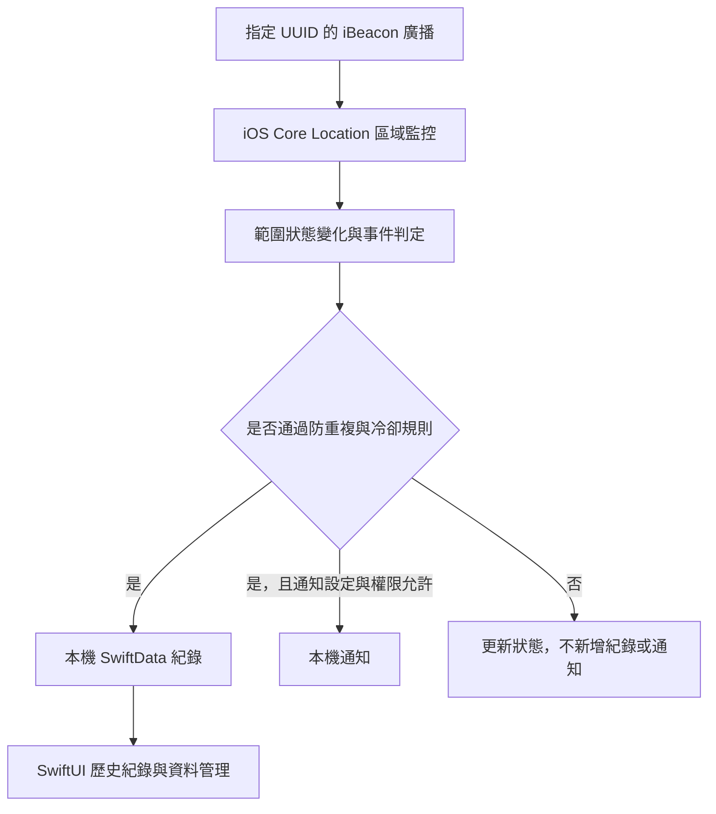

  

# iBeaconLog｜iOS iBeacon 進出紀錄工具

**讓進出紀錄留在自己的 iPhone：以 iBeacon 感知範圍變化，搭配本機儲存、通知與防重複機制，減少手動記錄的負擔。**

iBeaconLog（開發專案名稱：BeaconLogger）是使用 Swift、SwiftUI、SwiftData 與 Core Location 開發的 iOS 原生 App。它針對指定 iBeacon 的進入與離開建立時間紀錄，適合個人工作場所、工作室等固定場域的輔助紀錄。

> **這是產品與技術展示 repo，不是 App 原始碼發布庫。**
> 本 repo 僅提供專案介紹、功能說明與展示素材；完整 App 原始碼及開發歷史保留於 Private 主 repo，未在此公開。

| 專案概況 | 說明 |
| --- | --- |
| 支援平台 | iPhone，iOS 17 以上 |
| 展示版本 | 1.1.1 |
| 技術 | Swift 6、SwiftUI、SwiftData、Core Location、UserNotifications、XCTest |
| Beacon 設定 | 最多 5 組具名 iBeacon，以 UUID 辨識 |
| 資料處理 | 本機儲存；無後端、無登入、無廣告、無第三方分析或追蹤 SDK |
| 介面語言 | 繁體中文；紀錄時間使用台北時區 |

## 為什麼做這個 App？

想回顧自己何時到達或離開固定場所，不一定需要完整的雲端考勤系統。手動記錄容易遺漏，而持續追蹤移動路線也超出這個需求。

iBeaconLog 聚焦於「進入指定 Beacon 範圍」與「離開指定 Beacon 範圍」兩種事件。完成設備與權限設定後，由 iOS 的區域監控提供狀態變化，App 將符合規則的事件保存在手機上，讓使用者能隨時查看和整理。

## 優點與使用好處

| 設計重點 | 使用者得到的好處 |
| --- | --- |
| 自動接收進出變化 | 減少每次到達、離開都要手動操作的負擔，方便事後回顧時間 |
| 本機優先 | 不需建立帳號，也不需部署資料庫或伺服器；核心紀錄流程不依賴後端連線 |
| 聚焦區域事件 | 不讀取或保存 GPS 座標，不建立移動路線 |
| 名稱搭配 UUID | 紀錄以易讀名稱辨識場域，不必在歷史清單中辨讀長串 UUID |
| 每組 Beacon 獨立計算冷卻 | 降低範圍邊界訊號反覆變化造成的紀錄與通知雜訊 |
| 完整時間與資料整理 | 可查閱日期、星期、秒數，並依需要篩選或清除紀錄 |
| 訊號診斷與測試支援 | 實機遇到問題時能確認是否收到廣播，並保留模擬事件服務供開發驗證 |
| 原生 Apple 技術 | 將介面、資料保存、權限、背景事件與通知整合成完整的 iOS 使用流程 |

## 完整功能介紹

### 1. 具名 iBeacon 管理

- 最多新增 5 組 iBeacon，每組設定名稱與不同的 UUID。
- 可新增、編輯、刪除 Beacon 設定；套用後更新背景監控條件。
- 接受標準連字號格式及 32 位無連字號 UUID，儲存時統一格式。
- 驗證空白名稱、無效 UUID、重複 UUID 與數量上限。
- 只用 UUID 辨識，不提供 Major／Minor 的設定或顯示；相同 UUID 的多顆 Beacon 無法個別區分。
- 刪除 Beacon 設定不會連帶刪除既有進出紀錄。

### 2. 進入／離開偵測與監控狀態

- 接收 iOS 提供的指定 Beacon 範圍變化，建立進入或離開紀錄。
- 可手動啟動與停止監控，查看每組 Beacon 的監控與範圍狀態。
- 顯示定位、通知與監控狀態；有設定問題時引導前往設定頁。
- 未知狀態或新監控條件的首次判定作為基準，避免把初始化誤記為一次進出。
- 保留監控啟用狀態，App 再次啟動時嘗試恢復監控；背景喚醒仍由 iOS 決定。

### 3. 冷卻時間與防重複紀錄

- 可選 0、5、10、15、30 分鐘，或 1 至 7 小時的冷卻時間。
- 所有 Beacon 共用所選冷卻長度，但各自從最近一次接受的實體事件計算。
- 冷卻期間仍更新範圍狀態，不新增進出紀錄或通知；被忽略的事件不延長冷卻。
- 冷卻到期後，下一次有效進出變化可重新紀錄，不需等到隔日或手動清除。
- 0 分鐘代表停用冷卻，但相同狀態的重複回報仍不新增紀錄。
- 提供手動重置防重複狀態，方便測試與排查。

例如：冷卻設為 5 分鐘，09:00 記錄進入、09:02 離開被忽略；若 09:06 再收到進入變化，就能新增進入紀錄。若一直待在範圍內，冷卻到期也不會自行補上一筆紀錄。

這個設計是在紀錄密度與訊號穩定性之間做取捨：冷卻期間內的真實進出也可能被忽略，事後不會補寫。

### 4. 歷史紀錄與清理

- 以 SwiftData 將紀錄保存在裝置本機，重新開啟 App 後仍可查看。
- 紀錄依日期分組、由新到舊排列，支援「全部／進入／離開」篩選。
- 每筆顯示 Beacon 名稱、事件種類、完整日期、星期與時間；模擬事件另有標示。
- 日期文字允許換行，完整顯示秒數，不以省略號截斷。
- 支援滑動刪除單筆、多選批次刪除、刪除 30 天前、90 天前及全部紀錄。
- 批次與期間清理提供確認步驟，操作後顯示結果。

時間顯示使用 `zh_TW` 與 `Asia/Taipei`，格式為 `yyyy/MM/dd EEEE 在 HH:mm:ss`，例如：`2026/07/22 星期三 在 16:37:46`。

### 5. 本機通知

- 可啟用或關閉進出通知，也能分別控制進入通知與離開通知。
- 通知由裝置本機產生，不依賴推播伺服器。
- 顯示系統通知授權狀態，提供權限要求與前往 iOS 設定的入口。
- 被冷卻機制忽略的實體事件不發出通知；模擬事件依通知設定處理。

### 6. 模擬事件支援（開發用途）

- 服務層保留「模擬進入」與「模擬離開」實作，可針對已設定的 Beacon 建立測試事件。
- 可供開發時驗證紀錄與本機通知流程，無須依賴實體 Beacon 廣播。
- 模擬紀錄清楚標示「模擬測試」，便於與實體事件區分。
- 模擬事件不受實體事件冷卻限制，也不改寫實體事件的冷卻起點。
- **目前介面尚未提供觸發模擬事件的按鈕**，因此此項是保留的開發支援，並非可由一般使用者直接操作的功能。
- 模擬測試用於操作與資料流程驗證，不能取代真實 iBeacon 的背景接收測試。

### 7. 前景訊號診斷

- 在設定頁手動啟動 UUID 篩選的 iBeacon ranging，確認手機是否收到廣播。
- 逐組顯示訊號診斷結果，協助區分設備廣播問題與背景監控問題。
- 可手動停止；離開設定頁時也會停止診斷，減少不必要的掃描。
- 診斷不建立進出紀錄，也不讀取或保存 GPS 座標。

### 8. 權限、設定與隱私入口

- 提供定位與背景監控權限說明，並可開啟 iOS 系統設定。
- 保存 Beacon 設定、冷卻時間與通知偏好。
- 顯示 App 版本，提供隱私權政策與使用支援連結。
- 支援將舊版單一 Beacon 設定轉換為具名設定，保留既有使用資料。

## 技術設計與展示重點

上圖是實體事件的概念流程，展示資料如何留在裝置內，不包含 App 實作程式碼。

| 技術 | 本專案的實際應用與展示能力 |
| --- | --- |
| Swift 6 | 使用 Swift 6 語言模式與嚴格並行檢查，管理非同步監控工作與介面狀態 |
| SwiftUI | 設定表單、狀態回饋、紀錄清單、篩選、多選與刪除流程 |
| SwiftData | 事件資料建模、本機持久化、排序查詢與資料清理 |
| Core Location | iOS 17 以上使用 CLMonitor 與 UUID 條件監控；前景 ranging 提供診斷 |
| 背景生命週期 | iOS 18 以上使用 CLServiceSession 表達背景授權需求，並處理監控恢復與資料層尚未就緒時的待寫入事件 |
| UserNotifications | 本機通知、授權狀態管理與依事件種類套用使用者偏好 |
| XCTest | 驗證冷卻邊界、跨日情境、UUID 驗證、設定保存與遷移、日期格式及導覽狀態 |

### 設計取捨

- **UUID-only 設定**：減少設定項目，適合不同 UUID 對應不同場域；不提供以 Major／Minor 區分同 UUID 裝置的管理功能。
- **事件驅動**：依範圍變化處理紀錄，不持續追蹤 GPS，也不靠背景倒數計時器補寫事件。
- **狀態與紀錄分開處理**：冷卻期間仍更新範圍狀態，降低忽略一次離開後，後續進入被錯誤當作重複事件的問題。
- **本機資料與本機通知**：減少帳號和伺服器維運需求；目前未提供雲端同步、多裝置共用或管理後台。
- **診斷與正式紀錄分開**：可檢查廣播接收狀況，避免診斷操作污染進出歷史。

## 如何使用

1. 準備相容的 iBeacon，確認設備的 UUID 與廣播狀態。
2. 在 App 新增名稱與 UUID，選擇適合的冷卻時間及通知偏好。
3. 依 iOS 流程授予定位權限；背景監控需要「永遠」定位授權，通知需另行允許。
4. 套用設定並啟動背景監控；必要時先使用前景訊號診斷確認接收狀況。
5. 實際進入或離開範圍後，查看紀錄與通知，並依需求整理歷史資料。

本 repo 不提供完整 Xcode 專案、可下載安裝檔或公開測試邀請。

## 隱私與資料處理

- 不需要帳號或登入，不提供後端 API。
- 不讀取或保存 GPS 座標，不建立 GPS 移動軌跡。
- 不將進出紀錄傳送至網路或伺服器。
- 不包含廣告、第三方分析或追蹤 SDK；目前未引入第三方套件。
- 紀錄保存在本機 SwiftData；使用者可在 App 內刪除資料。
- 點選隱私權政策或使用支援時會開啟外部網頁，與進出紀錄的本機處理流程分開。

## 測試與已知限制

現有 XCTest 涵蓋 23 個測試案例，包括冷卻剛好到期、冷卻內反向事件、跨日仍未到期、跨日已到期、0 分鐘、延遲的較早事件、UUID 格式與重複驗證、5 組上限、設定保存及舊版遷移、完整日期顯示與導覽狀態。

2026/10/05 驗證：Xcode 27.0、iPhone 17 Pro／iOS 26.5 Simulator，build 成功，23/23 項單元測試通過。建置工具僅提示未使用 App Intents，略過對應中繼資料擷取；本次未進行實體 Beacon 測試。

- iOS Simulator 可驗證介面與資料流程，但無法驗證真實 iBeacon 廣播；模擬事件目前也沒有使用者介面入口。
- 實體偵測仍須搭配 iPhone 與實體 Beacon 測試；單元測試通過不代表所有背景情境都已驗證。
- iBeacon 範圍不是精準公尺或門線判定，事件可能延遲；牆面、人體、發射功率、廣播間隔、電池與擺放位置都會影響結果。
- iOS 決定背景排程與喚醒時機。App 無法自行提高使用者授權，也不保證隨時常駐或即時送達每個事件。
- 定位、藍牙、相關背景設定及通知授權會影響可用功能；前景收到訊號不代表背景事件一定立即發生。
- 冷卻有助於減少重複，但可能忽略短時間內的真實往返；請依紀錄用途選擇長度。
- 適合個人與輔助紀錄，不宜直接作為薪資計算、正式出勤認定或門禁安全依據。

## 公開範圍與相關連結

`BeaconLogger-Showcase` 是獨立建立的公開展示 repo，僅包含展示文件與素材。開發主 repo `BeaconLogger` 維持 Private，完整 App 原始碼、測試實作、Xcode 專案、建置設定與開發歷史不在此發布。

公開展示不代表提供完整原始碼或 App 原始碼的開源授權；本頁的用途是說明作品成果、功能與技術設計。

- [隱私權政策](https://eltonchung.github.io/my-ios-tool-privacy/)
- [使用支援](https://eltonchung.github.io/my-ios-tool-privacy/support.html)
- [作者 GitHub](https://github.com/eltonchung)
